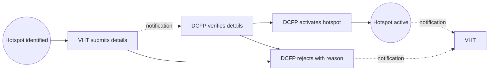

# Hotspots

[Module architecture](README.md)

A village health team member (VHT) submits a newly identified hotspot. The district condom focal person (DCFP, role `dfcp`) is notified, verifies the details and activates the hotspot, or rejects the submission with a reason. The VHT is notified of the outcome.

| Method | Route                                    | Permission          |
| ------ | ---------------------------------------- | ------------------- |
| GET    | `/api/v1/hotspots`                       | `hotspots:read`     |
| POST   | `/api/v1/hotspots`                       | `hotspots:submit`   |
| GET    | `/api/v1/hotspots/districts`             | `hotspots:submit`   |
| GET    | `/api/v1/hotspots/notifications`         | `hotspots:read`     |
| POST   | `/api/v1/hotspots/{id}/actions/{action}` | `hotspots:activate` |

1. The VHT picks the district from `GET /api/v1/hotspots/districts` and posts the hotspot `name` and `district_id`. They can also include the `type` of place, `village`, contact person name and telephone, `has_condom_dispenser` with its `dispenser_condition` (`Good`, `Poor` or `Broken`), `latitude` with `longitude`, and a `comment`. The hotspot starts as `submitted`, and the district receives a `submitted` notification.
2. The DCFP reads `GET /api/v1/hotspots/notifications` or lists `GET /api/v1/hotspots?status=submitted`. They run the `verify` action, which moves the hotspot to `verified`.
3. The DCFP runs `activate`, which moves the hotspot to `active`. At either earlier step they can instead run `reject` with a `reason`, which moves the hotspot to `rejected` and records `rejection_reason`. Activation and rejection notify the submitting VHT. Any other order returns HTTP 409. Each step records an event with the acting user.

A DCFP acts on hotspots in the district of their assigned store (`users.store_id` → `stores.district_id`), as in the [orders workflow](orders.md). A hotspot outside that district returns HTTP 404, or 403 for one they can see as its submitter. VHTs see the hotspots they submitted and their own notifications. `hotspots:all_districts` extends these permissions to every district. Lists use `limit` (default 50, maximum 100), `offset` and an optional `status`.

In the web app, DCFPs review the queue under **District focal person → Hotspots** and VHTs submit and follow their hotspots under **Village health team → My hotspots**. Both pages list recent notifications. The hotspot map plots the 100 most recent hotspots the user can see.

Migrations 8 and 9 grant every hotspot permission to `admin` only. Grant `hotspots:read` and `hotspots:submit` to `vht`, and `hotspots:read` and `hotspots:activate` to `dfcp`, through `PUT /api/v1/roles/{id}/permissions`. Assign each DCFP the district store. Legacy hotspots keep their recorded status and are outside this workflow. A rejected hotspot stays rejected; the VHT submits a corrected one.
