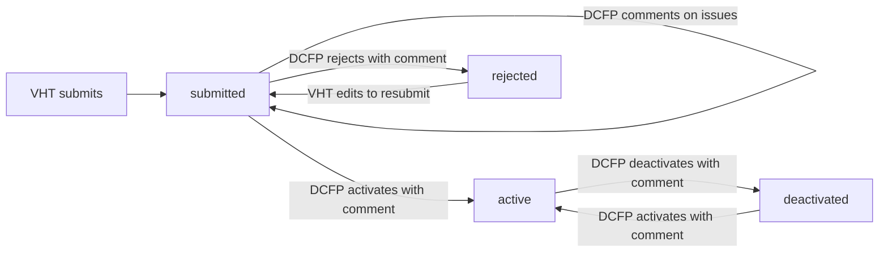

# Hotspots

[Module architecture](README.md)

A village health team member (VHT) submits a hotspot they identified. The district condom focal person (DCFP, role `dfcp`) is notified, verifies the details and activates the hotspot, comments on any issues, or rejects it with a reason. A DCFP can later deactivate and reactivate a hotspot.

## Statuses

A hotspot's `status` is only ever `active` or `inactive`. Its `review_status` records the workflow step behind it:

| `review_status` | `status`   | Meaning                                   |
| --------------- | ---------- | ----------------------------------------- |
| `submitted`     | `inactive` | Awaiting the DCFP's decision              |
| `rejected`      | `inactive` | Rejected; the VHT can edit it to resubmit |
| `active`        | `active`   | In use                                    |
| `deactivated`   | `inactive` | Taken out of use after being active       |

## Endpoints

| Method | Route                              | Permission          | Who                                |
| ------ | ---------------------------------- | ------------------- | ---------------------------------- |
| GET    | `/api/v1/hotspots`                 | `hotspots:read`     | VHT, DCFP, national users          |
| POST   | `/api/v1/hotspots`                 | `hotspots:submit`   | VHT                                |
| GET    | `/api/v1/hotspots/notifications`   | `hotspots:read`     | VHT, DCFP                          |
| GET    | `/api/v1/hotspots/regions`         | `hotspots:submit`   | VHT (form lookup)                  |
| GET    | `/api/v1/hotspots/districts`       | `hotspots:submit`   | VHT (form lookup, `?region_id=`)   |
| GET    | `/api/v1/hotspots/subcounties`     | `hotspots:submit`   | VHT (form lookup, `?district_id=`) |
| GET    | `/api/v1/hotspots/{id}`            | `hotspots:read`     | VHT, DCFP, national users          |
| PUT    | `/api/v1/hotspots/{id}`            | `hotspots:submit`   | Submitting VHT                     |
| GET    | `/api/v1/hotspots/{id}/events`     | `hotspots:read`     | VHT, DCFP, national users          |
| POST   | `/api/v1/hotspots/{id}/comments`   | `hotspots:read`     | Submitting VHT, DCFP               |
| POST   | `/api/v1/hotspots/{id}/activate`   | `hotspots:activate` | DCFP of the district               |
| POST   | `/api/v1/hotspots/{id}/deactivate` | `hotspots:activate` | DCFP of the district               |
| POST   | `/api/v1/hotspots/{id}/reject`     | `hotspots:activate` | DCFP of the district               |

Lists return the hotspots directly as `data`, most recently updated first; a comment counts as an update. They accept `limit` (default 50, maximum 100), `offset` and these filters, which only narrow what the caller can already see:

- `status`: `active` or `inactive`
- `review_status`: for example `submitted` for the DCFP's review queue
- `submitted_by_id`: one VHT's hotspots
- `district_id`: one district's hotspots

## Rules

- **Visibility:** a VHT (`hotspots:submit`) sees the hotspots they submitted. A DCFP (`hotspots:activate`) sees every hotspot in the district of their assigned store (`users.store_id`). `hotspots:all_districts` sees every hotspot, for national users. Anything else returns HTTP 404.
- **Submission:** these fields are required:
  - name and type
  - `region_id`, `district_id` and `subcounty_id`
  - latitude and longitude
  - contact person name and phone; the contact person is the hotspot manager
  - `has_condom_dispenser`

  `village`, `dispenser_condition` and `comment` are optional. The comment becomes the first in the hotspot's thread. Type and dispenser condition are free text, as in the legacy system. The subcounty must belong to the district and the district to the region.

- **Unique names:** two hotspots in the same village cannot share a name, ignoring case and extra spaces. Hotspots without a village are compared with each other. Legacy hotspots without a subcounty are compared within their district.
- **Editing:** only the submitter can edit, and only while the hotspot is inactive. Editing a rejected hotspot resubmits it. A deactivated hotspot cannot move to another district, so an edit cannot hand a DCFP's decision to another district. A changed contact person is added as a new `contact_persons` row, keeping earlier contacts.
- **Decisions:** activate (from submitted or deactivated), deactivate (from active) and reject (from submitted) each require a comment. The comment is stored with the decision as its `action`. Any other order returns HTTP 409.

## Notifications

Every step writes a `hot_spot_events` row. The rows are the hotspot's history (`/events`) and the in-app inbox (`/notifications`). An event's `status` is the review status after the step.

| Event         | Sent to                                                          |
| ------------- | ---------------------------------------------------------------- |
| `submitted`   | The hotspot's district, read by its DCFPs                        |
| `updated`     | The district                                                     |
| `resubmitted` | The district                                                     |
| `commented`   | The district if the submitter commented, otherwise the submitter |
| `activated`   | The submitter                                                    |
| `deactivated` | The submitter                                                    |
| `rejected`    | The submitter                                                    |

Rows are written in the same transaction as the change. A push or SMS notification service can deliver any row with `notify_district_id` or `notify_user_id` without changing this module.

## Setup

Migrations 8 and 15 grant the hotspot permissions to `admin` only. Grant the other roles through `PUT /api/v1/roles/{id}/permissions`:

- `vht`: `hotspots:read` and `hotspots:submit`
- `dfcp`: `hotspots:read` and `hotspots:activate`
- national roles such as `moh`: `hotspots:read` and `hotspots:all_districts`

Migration 15 fills `regions`, `districts`, `subcounties` and one store per district from `organization_units`. It assigns each legacy DCFP to their district's store. New DCFP accounts need `store_id` set to their district store.

## Legacy data

See [PostgreSQL and legacy imports](../postgresql.md#hotspot-conversion) for how legacy hotspots and earlier submissions are converted, and how to list the hotspots that need cleanup.
