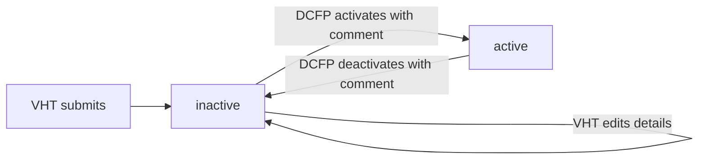

# Hotspots

[Module architecture](README.md)

The hotspots module covers mapping a hotspot and its activation. A village health team member (VHT) submits a hotspot. The district condom focal person (DCFP) for that district verifies it, comments on any issues and activates it. A DCFP can later deactivate or reactivate it.

A hotspot is only ever `active` or `inactive`. A new submission stays `inactive` until it is activated.

## Endpoints

| Method | Route                              | Permission        | Who                  |
| ------ | ---------------------------------- | ----------------- | -------------------- |
| GET    | `/api/v1/hotspots`                 | `hotspots:read`   | VHT, DCFP            |
| POST   | `/api/v1/hotspots`                 | `hotspots:submit` | VHT                  |
| GET    | `/api/v1/hotspots/notifications`   | `hotspots:read`   | VHT, DCFP            |
| GET    | `/api/v1/hotspots/{id}`            | `hotspots:read`   | VHT, DCFP            |
| PUT    | `/api/v1/hotspots/{id}`            | `hotspots:submit` | Submitting VHT       |
| GET    | `/api/v1/hotspots/{id}/events`     | `hotspots:read`   | VHT, DCFP            |
| POST   | `/api/v1/hotspots/{id}/comments`   | `hotspots:read`   | Submitting VHT, DCFP |
| POST   | `/api/v1/hotspots/{id}/activate`   | `hotspots:verify` | DCFP of the district |
| POST   | `/api/v1/hotspots/{id}/deactivate` | `hotspots:verify` | DCFP of the district |

Lists accept `status` (`active` or `inactive`), `limit` (default 50, maximum 100) and `offset`. They return the most recently updated hotspots first, and a comment counts as an update.

## Rules

- **Visibility:** a VHT sees only the hotspots they submitted. A DCFP sees every hotspot in the district of their assigned store (`users.store_id`). Anyone else gets HTTP 404.
- **Submission:** these fields are required:
  - name and type
  - `region_id`, `district_id` and `subcounty_id`
  - village
  - latitude and longitude
  - contact person name and phone
  - `has_condom_dispenser`

  `dispenser_condition` and a `note` are optional; the note becomes the first comment. Type and dispenser condition are free text, as in the legacy system. The subcounty must belong to the district and the district to the region.

- **Unique names:** two hotspots in the same village cannot share a name, ignoring case and extra spaces. Legacy hotspots without a subcounty are compared within their district.
- **Hotspot manager:** the submitter manages the hotspot unless `hotspot_manager_id` names another active user. Managers are stored in `hot_spot_user`. The module does not change `users.hot_spot_id`, which the orders workflow uses.
- **Editing:** only the submitter can edit, and only while the hotspot is inactive. A changed contact person is added as a new `contact_persons` row, so earlier contacts are kept.
- **Comments:** a hotspot can have many comments. Activation and deactivation require one, stored with the action (`activated` or `deactivated`).

## Notifications

Every step writes a `hot_spot_events` row, following the pattern of `order_events`. The rows are the hotspot's history (`/events`) and the in-app inbox (`/notifications`).

| Event         | Sent to                                                                |
| ------------- | ---------------------------------------------------------------------- |
| `submitted`   | The district store, read by its DCFPs                                  |
| `updated`     | The district store                                                     |
| `commented`   | The district store if the submitter commented, otherwise the submitter |
| `activated`   | The submitter                                                          |
| `deactivated` | The submitter                                                          |

Rows are written in the same transaction as the change. A push or SMS notification service can deliver any row that has `notify_store_id` or `notify_user_id` without changing this module.

## Setup

Migration 8 grants the hotspot permissions to `admin` only. Grant the other roles through the RBAC API:

- `vht`: `hotspots:read` and `hotspots:submit`
- `dfcp`: `hotspots:read` and `hotspots:verify`

Migration 8 also fills `regions`, `districts`, `subcounties` and one store per district from `organization_units`. It assigns each legacy DCFP to their district's store. New DCFP accounts need `store_id` set to their district store before they can see or verify hotspots.

## Legacy data

See [PostgreSQL and legacy imports](../postgresql.md#hotspot-conversion) for how legacy hotspots are converted and how to list the ones that need cleanup.
